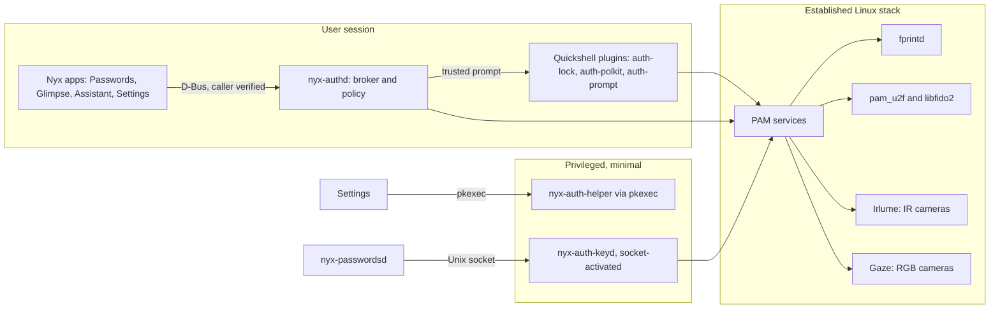

# Architecture

Nyx Biometrics adds no authentication of its own. Faces are matched by Irlume or Gaze,
fingerprints by fprintd, security keys by pam_u2f and libfido2, passwords by pam_unix.
What Nyx adds is one policy for all of them, safe PAM wiring, one trusted prompt for apps,
and the glue that lets Nyx Passwords use them without weakening its encryption.



## Components

| Component | Runs as | Role |
|---|---|---|
| `nyx-auth-core` | library | Methods, assurance levels, surfaces, policy engine. No I/O. |
| `nyx-auth-proto` | library | `io.github.design_nexus.nyx.Auth1` types and client. MIT, for other repos. |
| adapters | library | Discovery and enrollment for fprintd, FIDO2, Irlume, Gaze; mocks for tests. |
| `nyx-authctl` | user | Command line: `doctor`, status, enrollment, policy. |
| `nyx-authd` | user, D-Bus activated | The broker: app requests, trusted prompt, grants, audit log. |
| `nyx-auth-pam` | library | Generates, parses and tests PAM stacks. |
| `nyx-auth-helper` | root, via pkexec | Applies PAM changes, rollback, system enrollment files. |
| `nyx-auth-keyd` | root, socket-activated | Releases a TPM-sealed Vault wrapping key after its own biometric PAM check. |
| QML `NyxAuth` | user | The four overlay styles, shared by every plugin and the SDDM theme. |

`nyx-auth-keyd` is the only new background piece, and it isn't resident: systemd starts it
when Nyx Passwords connects. Everything else is a library, a command, or a D-Bus-activated
user service that exits when idle.

## Assurance

Each method is rated by what a success actually shows (`nyx-auth-core/src/method.rs`):

| Method | Factor | Level | Identifies the person |
|---|---|---|---|
| Password | knowledge | one factor | yes |
| Fingerprint | inherence | one factor | yes |
| Face, infrared with liveness | inherence | one factor | yes |
| Face, infrared without liveness | inherence | presence | no |
| Face, RGB webcam (even with Gaze's liveness) | inherence | presence | no |
| Security key, touch | possession | one factor | **no** |
| Security key, PIN or on-key sensor plus touch | possession | verified security key | yes |

Levels, lowest first: **presence**, **one factor**, **verified security key**, **two
factors**. Two factors means two methods of different kinds that each count as a factor
on their own, so a webcam face match never turns a password into two factors.

A level is a floor, not an equivalence. A policy names which methods it accepts; reaching
the same level doesn't make an unlisted method acceptable.

A touch proves someone is holding the key, not who. Policies can require identity
(`identity_required`), which refuses touch-only keys and presence-level faces. Vault and
sensitive app actions require it by default.

## Policy

One file, `~/.config/nyx/auth/policy.toml`, with a table per surface: `login`,
`lock-screen`, `sudo`, `polkit`, `vault`, `app-action`. Each has:

- `methods`: alternatives in preference order, each enough on its own.
- `require-all`: methods only enough together (password plus security key).
- `minimum`: the floor every alternative must reach.
- `identity-required`: refuse methods that don't identify.
- `security-key`: `touch` or `verified` (PIN or sensor) for every key on this surface.
- `selection`: `automatic`, `ordered` or `manual`.
- `timeout-secs`: 5 to 120.

`SurfacePolicy::plan` checks a policy against the hardware and either resolves it or lists
every problem. It refuses, never quietly drops:

- a listed method that falls below the floor or doesn't identify when it must;
- `verified` keys when any registered key has no PIN or sensor;
- a system surface without a password path;
- a password-plus-key rule on a system surface with only one registered key.

The default policy is password only everywhere, which is what the machine does today.
Setup proposes `PolicySet::recommended`, and nothing changes until the person accepts.

**Changing the policy** needs authentication that the current policy of every changed
surface accepts (`PolicySet::approval`), so newly added methods can't approve their own
addition. Changes to system surfaces then go through the root helper.

## Surfaces and how each is enforced

| Surface | Enforced by | Concurrency |
|---|---|---|
| Login | SDDM, PAM service `sddm` | one stack, sequential |
| Lock screen | `design-nexus.auth-lock`, services `nyx-lock-password`, `nyx-lock-fingerprint`, `nyx-lock-face`, `nyx-lock-key` | separate contexts at once |
| sudo | PAM service `sudo` | one stack, sequential |
| Polkit | PAM service `polkit-1`, prompt `design-nexus.auth-polkit` | one stack, sequential |
| Vault | `nyx-passwordsd` with `nyx-authd` and `nyx-auth-keyd` | broker |
| App actions | the app's own daemon with `nyx-authd` | broker |

### PAM wiring

Each target file gets one marked line and nothing else:

```text
# BEGIN nyx-biometrics (managed; remove with: nyx-authctl pam restore)
auth  include  nyx-auth-sudo
# END nyx-biometrics
```

`/etc/pam.d/nyx-auth-sudo` holds the generated stack. For a sequential surface, each
method is preceded by a gate, in the policy's order (or face, fingerprint, key):

```text
auth  [success=1 default=ignore]  pam_exec.so quiet /usr/lib/nyx-biometrics/nyx-auth-gate built-in
auth  sufficient  pam_irlume.so
auth  [success=1 default=ignore]  pam_exec.so quiet /usr/lib/nyx-biometrics/nyx-auth-gate built-in
auth  sufficient  pam_fprintd.so max-tries=2 timeout=30
auth  [success=1 default=ignore]  pam_exec.so quiet /usr/lib/nyx-biometrics/nyx-auth-gate local
auth  sufficient  pam_u2f.so cue authfile=/etc/nyx-biometrics/u2f_keys [pinverification=1]
```

followed by the file's existing password lines, untouched.

**The gate exits 0 to skip** the next line. In Linux-PAM a numeric jump behaves like `ok`,
so a gate that skipped by *failing* would record a failure that sinks a correct password.
Exiting 0 records success, which the password stack's own `required` lines still override.
This is the pattern Omarchy uses for its lid check. The gate skips when:

- `PAM_RHOST` names another host;
- the program running PAM descends from `sshd`, `sshd-session`, `mosh-server` or similar;
- logind says that program's session is remote, or it has no session (cron, services);
- the user's display session isn't local, on a seat and active;
- for `built-in` (face, fingerprint): the lid is closed.

Anything it can't establish counts as a reason to skip. If the gate itself is missing, PAM
treats it as `ignore` and the method runs; `nyx-auth-helper` refuses to apply a stack while
the gate isn't installed.

The polkit helper is socket-activated by systemd (`polkit-agent-helper@.service`), so it
has no session or useful ancestry; for `polkit-1` the user's display session decides. That
unit also runs with `PrivateDevices=yes`, which hides security keys from `pam_u2f`. When a
key is allowed at administrator prompts, Nyx adds a drop-in
(`50-nyx-security-keys.conf`: `PrivateDevices=no`, `DevicePolicy=closed`,
`DeviceAllow=char-hidraw rw`) so the helper reaches hidraw devices and nothing else new.

`require-all = ["password", "security-key"]` compiles to a second block after the
password, `auth include nyx-auth-sudo-required`, holding `pam_u2f` as `required` without
a gate: over SSH it can't be satisfied, so remote sudo fails closed.

Applying a change (`nyx-authctl pam apply SURFACE`):

1. `nyx-authctl` generates the stack as the user, runs every check, and shows the diff and
   a change ID. Nothing needs root yet (`pam preview` stops here).
2. After you type `yes`, the helper is given the **policy**, not PAM text. It probes the
   hardware itself, regenerates, re-runs the checks, and refuses unless the result has the
   change ID you saw.
3. It snapshots every file it will touch to `/var/lib/nyx-biometrics/pam-backups/<ID>/`,
   writes generated stacks before the target's include line (temp file, fsync, rename),
   and only writes paths on a fixed list. It never deletes a file Nyx didn't write.
4. It arms a 120-second `systemd-run` timer that restores the snapshot. If the timer
   can't be armed, it restores immediately.
5. `nyx-authctl` signs you in once against the changed service (a real `sudo`, or a PAM
   conversation with `polkit-1`, `sddm` or the lock service). Only if that works does it
   confirm, through an administrator prompt, which stops the timer.

`nyx-authctl pam restore [ID]` puts a snapshot back; from a root shell,
`nyx-auth-helper pam-rollback ID` does the same. See [RECOVERY.md](RECOVERY.md). Omarchy's
own `pam_u2f`, `pam_fprintd` and lid-gate lines are only removed with `--migrate-omarchy`;
otherwise their presence stops the apply, so no method runs twice.

### Checks before anything is written

`nyx_auth_pam::check::verify` re-reads the generated files rather than trusting the
generator. It refuses:

- a module outside `pam_irlume`, `pam_gaze`, `pam_fprintd`, `pam_u2f` in Nyx's files;
- a method line without a gate in front of it, or a gate not followed by exactly one method;
- `pam_permit` that could end the stack anywhere in the expanded target;
- a target whose expanded `auth` stack no longer reaches `pam_unix`;
- a pre block after the password, or a required block before it;
- anything but one required method in a `nyx-lock-*` service.

### Lock screen

`design-nexus.auth-lock` starts from `ken.lock` and keeps its behaviour: password and
fingerprint contexts run together, with Omarchy's fingerprint reachability handling.
It adds `nyx-lock-face` and `nyx-lock-key` contexts.

- Face starts only on an explicit wake or a key press and stops after its timeout. It
  doesn't keep the camera on, so being in front of the screen doesn't unlock it.
  Hands-free unlock is a separate opt-in.
- A key context runs only while a registered key is plugged in.
- Each context's result is reported separately; the first success unlocks.

### Overlays

One QML module, `NyxAuth`, draws all four styles (Circular Face Scan, Cyberpunk Scanner,
Minimal Floating, Edge Glow) for every method and state: scanning, success, failure,
timeout, PIN entry, password fallback. It is used by the lock plugin, the polkit plugin,
the `design-nexus.auth-prompt` plugin for app requests and sudo status, and the SDDM theme.
Styles, intensity and accent are chosen per surface in Settings. Colours come from the
Nyx Design 2.0 tokens exported by nyx-design; surfaces are solid.

Settings previews ask `auth-prompt` to show a style in preview mode, which never opens a
PAM context, a camera or a reader.

The sudo overlay is status only: a terminal `sudo` talks to PAM in the terminal, so the
overlay can show that face, fingerprint or key is being checked, not take input.

## The broker (`nyx-authd`)

Interface `io.github.design_nexus.nyx.Auth1` at `/io/github/design_nexus/nyx/Auth` on the
session bus. Methods: `Authenticate(Request) -> Reply`, `Check(action)`, `Revoke(action)`,
`Cancel()`, `Methods()`.

- **Caller identity** comes from the connection: uid, pidfd and executable path, checked
  the way `nyx-passwordsd` checks its peers. Each known caller has an action prefix
  (`io.github.design_nexus.nyx.passwords.` for Passwords); requests outside it are refused.
- **Purpose** is one short plain-text sentence. The prompt is polkit's `app-action`
  (`auth_self`) for the broker's own process, so the system face card answers; polkit
  lets only root pass a message of its own, so it shows the action's fixed text and the
  app says what it's for in its own window.
- **Policy**: the surface's policy (`vault` or `app-action`) must be one a single prompt
  can meet; one that wants two methods together is refused (`Unavailable`).
- **Started by D-Bus** on first use (`~/.local/share/dbus-1/services`), gone after ten
  quiet minutes with no grant. One prompt at a time (`Busy`); six requests a minute per
  caller. `Methods()` reports the `app-action` policy's methods (the broker can't see the
  hardware) and the password.
- **Clients connect with `nyx_auth_proto::connect`**, which checks the bus name's owner is
  this user's `nyx-authd` from where the suite installs it and talks to that connection
  only. Without a verified broker they ask polkit directly.
- **Grants** are bound to caller and action, last at most 5 minutes (0 means once), and end
  on any login1 session `Lock`, on `PrepareForSleep`, and when the broker exits.
- **No approve method.** Only a successful authentication at the broker's prompt grants,
  so an agent can't approve its own request.
- **Audit log**: one JSON line per request in `$XDG_STATE_HOME/nyx/auth/audit.jsonl`
  (caller, action, outcome, methods, time). Never purposes with user data, secrets or
  templates.

## Vault (Nyx Passwords)

Vaultwarden and the Bitwarden data model stay as they are. Three separate things:

1. **Unlocking the local vault** (decrypting the user key on this computer):
   - *Password*: unchanged.
   - *Face or fingerprint*: `nyx-auth-keyd` seals the user key to the TPM
     (`systemd-creds --with-key=tpm2`, with uid, app and name bound in) in a root-only
     directory. When `nyx-passwordsd` asks, keyd checks the peer (SO_PEERCRED, the
     executable on a fixed list, the start time against pid reuse), asks polkit with
     `pkcheck` whether that process may use an `auth_self` action, and only then unseals.
     polkit's prompt runs the `polkit-1` PAM stack, so whatever signs in to administrator
     prompts (here, hands-free face) confirms the person. A process running as the user
     can't skip that step, because the sealed key and the TPM are root's. A match is never
     itself the key.
   - *Why polkit and not a PAM service of keyd's own*: Irlume treats PAM service names it
     doesn't know restrictively, and polkit is how other Linux password managers ask for
     "system authentication". It also means the Vault follows the administrator-prompt
     methods rather than a separate list; the `vault` row of the policy documents intent
     until Passwords enforces its own re-prompt rules.
   - *Security key*: the FIDO2 `hmac-secret` extension derives the wrapping key from the
     key itself, with touch (and PIN if set). This is a real cryptographic factor.
   - Both expire with the vault's lock rules and are dropped when the password changes, the
     server reports new keys, or the person turns them off. The password always works.
2. **Signing in to Vaultwarden** (two-step login): FIDO2/WebAuthn as a second step,
   alongside the existing methods. It protects the account, not the local data.
3. **Re-authentication** for revealing, copying or exporting protected items, using the
   broker at the `vault` policy. This gates access in the daemon; it isn't separate
   encryption per item.

Passkeys stay in Bitwarden's `fido2Credentials` format. When a site requires user
verification, the daemon gets a fresh broker authentication (`passkey-verify`) before
signing or making a passkey; otherwise an unlocked vault counts, as in the official
clients. Hardware-bound passkeys stay on the hardware key and go through the browser.

## Privileged helper (`nyx-auth-helper`)

Follows `nyx-assistant-helper`: one polkit action per verb, argv-matched, `auth_admin`,
fixed verb list, every argument parsed again, absolute paths, cleared environment, a
root-owned log of what changed. Verbs: `pam-apply`, `pam-confirm`, `pam-restore`,
`keys-write` (the system authfile), `packages-install` (a fixed allowlist). It is shaped so
it can move into a shared Nyx System Manager when one exists.

## Testing

- Unit tests for the policy engine, assurance, PAM generation and parsing, the rollback
  state machine, broker request checks, and adapters against mocks (disconnects, timeouts,
  wrong finger, unknown face, wrong PIN, key removed, several keys).
- PAM stacks run in a Docker container (`crates/nyx-auth-pam/tests/container.rs`): Arch's
  stock `system-auth`, a test user, a real PAM conversation (`pam-try`), and `pam_exec`
  mocks for face, fingerprint, key and the gate that record every call. 22 cases cover each
  method passing, failing and timing out, remote and lid-closed skips, password plus key,
  the lock services, and restore. A deliberately broken gate makes it fail. Nothing
  touches the host's `/etc/pam.d`.
- QML plugins are checked on a headless, off-screen Hyprland output.
- Real hardware has a manual checklist in `HARDWARE.md`; each line stays "pending" until it
  has been run on the device.
