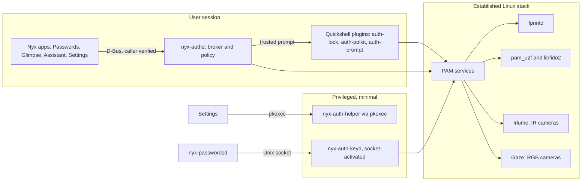

# Architecture

Nyx Biometrics adds no authentication of its own. Faces are matched by Irlume or Gaze,
fingerprints by fprintd, security keys by pam_u2f and libfido2, passwords by pam_unix.
What Nyx adds is one policy for all of them, safe PAM wiring, one trusted prompt for apps,
and the glue that lets Nyx Passwords use them without weakening its encryption.



## Components

| Component | Runs as | Role |
|---|---|---|
| `nyx-auth-core` | library | Methods, assurance levels, surfaces, policy engine. No I/O. |
| `nyx-auth-proto` | library | `io.github.design_nexus.nyx.Auth1` types and client. MIT, for other repos. |
| adapters | library | Discovery and enrollment for fprintd, FIDO2, Irlume, Gaze; mocks for tests. |
| `nyx-authctl` | user | Command line: `doctor`, status, enrollment, policy. |
| `nyx-authd` | user, D-Bus activated | The broker: app requests, trusted prompt, grants, audit log. |
| `nyx-auth-pam` | library | Generates, parses and tests PAM stacks. |
| `nyx-auth-helper` | root, via pkexec | Applies PAM changes, rollback, system enrollment files. |
| `nyx-auth-keyd` | root, socket-activated | Releases a TPM-sealed Vault wrapping key after its own biometric PAM check. |
| QML `NyxAuth` | user | The four overlay styles, shared by every plugin and the SDDM theme. |

`nyx-auth-keyd` is the only new background piece, and it isn't resident: systemd starts it
when Nyx Passwords connects. Everything else is a library, a command, or a D-Bus-activated
user service that exits when idle.

## Assurance

Each method is rated by what a success actually shows (`nyx-auth-core/src/method.rs`):

| Method | Factor | Level | Identifies the person |
|---|---|---|---|
| Password | knowledge | one factor | yes |
| Fingerprint | inherence | one factor | yes |
| Face, infrared with liveness | inherence | one factor | yes |
| Face, infrared without liveness | inherence | presence | no |
| Face, RGB webcam (even with Gaze's liveness) | inherence | presence | no |
| Security key, touch | possession | one factor | **no** |
| Security key, PIN or on-key sensor plus touch | possession | verified security key | yes |

Levels, lowest first: **presence**, **one factor**, **verified security key**, **two
factors**. Two factors means two methods of different kinds that each count as a factor
on their own, so a webcam face match never turns a password into two factors.

A level is a floor, not an equivalence. A policy names which methods it accepts; reaching
the same level doesn't make an unlisted method acceptable.

A touch proves someone is holding the key, not who. Policies can require identity
(`identity_required`), which refuses touch-only keys and presence-level faces. Vault and
sensitive app actions require it by default.

## Policy

One file, `~/.config/nyx/auth/policy.toml`, with a table per surface: `login`,
`lock-screen`, `sudo`, `polkit`, `vault`, `app-action`. Each has:

- `methods`: alternatives in preference order, each enough on its own.
- `require-all`: methods only enough together (password plus security key).
- `minimum`: the floor every alternative must reach.
- `identity-required`: refuse methods that don't identify.
- `security-key`: `touch` or `verified` (PIN or sensor) for every key on this surface.
- `selection`: `automatic`, `ordered` or `manual`.
- `timeout-secs`: 5 to 120.

`SurfacePolicy::plan` checks a policy against the hardware and either resolves it or lists
every problem. It refuses, never quietly drops:

- a listed method that falls below the floor or doesn't identify when it must;
- `verified` keys when any registered key has no PIN or sensor;
- a system surface without a password path;
- a password-plus-key rule on a system surface with only one registered key.

The default policy is password only everywhere, which is what the machine does today.
Setup proposes `PolicySet::recommended`, and nothing changes until the person accepts.

**Changing the policy** needs authentication that the current policy of every changed
surface accepts (`PolicySet::approval`), so newly added methods can't approve their own
addition. Changes to system surfaces then go through the root helper.

## Surfaces and how each is enforced

| Surface | Enforced by | Concurrency |
|---|---|---|
| Login | SDDM, PAM service `sddm` | one stack, sequential |
| Lock screen | `design-nexus.auth-lock`, services `nyx-lock-password`, `nyx-lock-fingerprint`, `nyx-lock-face`, `nyx-lock-key` | separate contexts at once |
| sudo | PAM service `sudo` | one stack, sequential |
| Polkit | PAM service `polkit-1`, prompt `design-nexus.auth-polkit` | one stack, sequential |
| Vault | `nyx-passwordsd` with `nyx-authd` and `nyx-auth-keyd` | broker |
| App actions | the app's own daemon with `nyx-authd` | broker |

### PAM wiring

Each target file gets one marked line and nothing else:

```text
# BEGIN nyx-biometrics (managed; remove with: nyx-authctl pam restore)
auth  include  nyx-auth-sudo
# END nyx-biometrics
```

`/etc/pam.d/nyx-auth-sudo` holds the generated stack. For a sequential surface it is, in
the policy's order:

```text
auth  [success=ignore default=N]  pam_exec.so quiet /usr/lib/nyx-biometrics/nyx-auth-gate
auth  sufficient  <face module>        # short timeout
auth  sufficient  pam_fprintd.so       max-tries=2 timeout=10
auth  sufficient  pam_u2f.so           cue authfile=… [pinverification=1]
```

followed by the file's existing password lines, untouched. The gate skips every non-password
module (N lines) when the session is remote (`PAM_RHOST` set, `SSH_CONNECTION` in the
calling process, or no active local logind seat) or the lid is closed. Omarchy's
clamshell check is folded into it.

`require-all = ["password", "security-key"]` compiles to `pam_unix` and `pam_u2f` both
`required`, with the password tried first.

Applying a change:

1. Generate the stack and a diff against `/etc/pam.d`.
2. Run the container suite on the generated files (below). Refuse if any case fails.
3. Snapshot every file it will touch to `/var/lib/nyx-biometrics/pam-backups/<time>/`.
4. Write files atomically (temp file in the same directory, fsync, rename).
5. Start a 120-second transient timer that restores the snapshot unless the person
   confirms, from a new `sudo` or a new terminal, that they can still authenticate.

`nyx-authctl pam restore` (and `nyx-auth-helper restore` from a root shell or TTY) puts back
the newest snapshot. Omarchy's own `pam_u2f` and `pam_fprintd` lines are detected and moved
into the managed block only with consent, so the two never run twice.

### Lock screen

`design-nexus.auth-lock` starts from `ken.lock` and keeps its behaviour: password and
fingerprint contexts run together, with Omarchy's fingerprint reachability handling.
It adds `nyx-lock-face` and `nyx-lock-key` contexts.

- Face starts only on an explicit wake or a key press and stops after its timeout. It
  doesn't keep the camera on, so being in front of the screen doesn't unlock it.
  Hands-free unlock is a separate opt-in.
- A key context runs only while a registered key is plugged in.
- Each context's result is reported separately; the first success unlocks.

### Overlays

One QML module, `NyxAuth`, draws all four styles (Circular Face Scan, Cyberpunk Scanner,
Minimal Floating, Edge Glow) for every method and state: scanning, success, failure,
timeout, PIN entry, password fallback. It is used by the lock plugin, the polkit plugin,
the `design-nexus.auth-prompt` plugin for app requests and sudo status, and the SDDM theme.
Styles, intensity and accent are chosen per surface in Settings. Colours come from the
Nyx Design 2.0 tokens exported by nyx-design; surfaces are solid.

Settings previews ask `auth-prompt` to show a style in preview mode, which never opens a
PAM context, a camera or a reader.

The sudo overlay is status only: a terminal `sudo` talks to PAM in the terminal, so the
overlay can show that face, fingerprint or key is being checked, not take input.

## The broker (`nyx-authd`)

Interface `io.github.design_nexus.nyx.Auth1` at `/io/github/design_nexus/nyx/Auth` on the
session bus. Methods: `Authenticate(Request) -> Reply`, `Check(action)`, `Revoke(action)`,
`Cancel()`, `Methods()`.

- **Caller identity** comes from the connection: uid, pidfd and executable path, checked
  the way `nyx-passwordsd` checks its peers. Each known caller has an action prefix
  (`io.github.design_nexus.nyx.passwords.` for Passwords); requests outside it are refused.
- **Purpose** is one short plain-text sentence shown next to the caller's name and icon.
- **Grants** are bound to caller and action, last at most 5 minutes (0 means once), and end
  on lock, sleep and logout.
- **No approve method.** Only a successful authentication at the broker's prompt grants,
  so an agent can't approve its own request.
- **Audit log**: one JSON line per request in `$XDG_STATE_HOME/nyx/auth/audit.jsonl`
  (caller, action, outcome, methods, time). Never purposes with user data, secrets or
  templates.

## Vault (Nyx Passwords)

Vaultwarden and the Bitwarden data model stay as they are. Three separate things:

1. **Unlocking the local vault** (decrypting the user key on this computer):
   - *Password*: unchanged.
   - *Face or fingerprint*: the user key is wrapped (AES-256-GCM, via `bitwarden-crypto`)
     under a random wrapping key. `nyx-auth-keyd` holds the wrapping key, sealed to the TPM
     and stored root-only. When `nyx-passwordsd` asks, keyd checks the peer, runs its own
     biometric-only PAM service `nyx-vault-unlock` for that uid, and only then returns the
     wrapping key. A process running as the user can't skip the biometric step, because
     the key lives with root. A successful match is never itself the key.
   - *Security key*: the FIDO2 `hmac-secret` extension derives the wrapping key from the
     key itself, with touch (and PIN if set). This is a real cryptographic factor.
   - Both expire with the vault's lock rules and are dropped when the password changes, the
     server reports new keys, or the person turns them off. The password always works.
2. **Signing in to Vaultwarden** (two-step login): FIDO2/WebAuthn as a second step,
   alongside the existing methods. It protects the account, not the local data.
3. **Re-authentication** for revealing, copying or exporting protected items, using the
   broker at the `vault` policy. This gates access in the daemon; it isn't separate
   encryption per item.

Passkeys stay in Bitwarden's `fido2Credentials` format. When a site asks for user
verification, the daemon gets a fresh broker authentication instead of always reporting
it. Hardware-bound passkeys stay on the hardware key and go through the browser.

## Privileged helper (`nyx-auth-helper`)

Follows `nyx-assistant-helper`: one polkit action per verb, argv-matched, `auth_admin`,
fixed verb list, every argument parsed again, absolute paths, cleared environment, a
root-owned log of what changed. Verbs: `pam-apply`, `pam-confirm`, `pam-restore`,
`keys-write` (the system authfile), `packages-install` (a fixed allowlist). It is shaped so
it can move into a shared Nyx System Manager when one exists.

## Testing

- Unit tests for the policy engine, assurance, PAM generation and parsing, the rollback
  state machine, broker request checks, and adapters against mocks (disconnects, timeouts,
  wrong finger, unknown face, wrong PIN, key removed, several keys).
- PAM stacks run in a Docker container (Arch, `pamtester`, mock `pam_exec` modules for
  face, fingerprint and key). Nothing touches the host's `/etc/pam.d`.
- QML plugins are checked on a headless, off-screen Hyprland output.
- Real hardware has a manual checklist in `HARDWARE.md`; each line stays "pending" until it
  has been run on the device.
